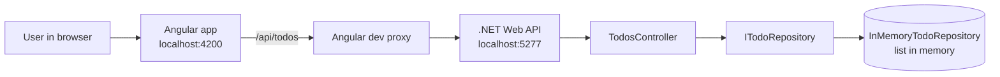

# Todo App

A small todo list app. You can add a todo, see all your todos, and delete a todo.

It has two parts:

- **Backend**: a .NET 11 Web API (the server) that keeps the todos
- **Frontend**: an Angular 22 app (the web page) that talks to the API

## How to run it

### What you need

- .NET 11 SDK. global.json pins the SDK to 11.0.100 or a later 11.0 feature band.
- Node.js 22 or 24 LTS, and npm. I used Node 24.18.

### 1. Start the API

```bash
dotnet run --project backend/Todo.Api
```

The API runs on `http://localhost:5277`. This port is configured in `backend/Todo.Api/Properties/launchSettings.json`.
If you change it, also change `target` in `frontend/proxy.conf.json`, or the Angular app can't reach the API.

### 2. Start the Angular app (in a second terminal)

```bash
cd frontend
npm install
npm start
```

Open `http://localhost:4200`.

---pro

## How it works

I used the Angular dev proxy to route all /api traffic to the .NET backend, skipping the need for CORS.



### Backend layers

| Layer         | File                                         | What it does                                                           |
| ------------- | -------------------------------------------- | ---------------------------------------------------------------------- |
| Controller    | `TodosController.cs`                         | Takes the HTTP request and returns the right status code               |
| Request model | `CreateTodoRequest.cs`                       | Checks the title (validation): required, not blank, max 200 characters |
| Repository    | `ITodoRepository` / `InMemoryTodoRepository` | Stores and removes todos                                               |
| Model         | `TodoItem.cs`                                | A todo: `Id`, `Title`, `CreatedAt`                                     |

The controller only knows about `ITodoRepository` (an interface), not the real class. So I can swap the storage later (for example, for a database) without changing the controller. The integration tests use the same idea to plug in a repository that always fails.

---

## API

Base URL: `http://localhost:5277`

| Method | URL               | What it does                                | Responses                                                 |
| ------ | ----------------- | ------------------------------------------- | --------------------------------------------------------- |
| GET    | `/api/todos`      | Get all todos, in the order they were added | `200`                                                     |
| POST   | `/api/todos`      | Add a todo. Body: `{ "title": "Buy milk" }` | `201` with a `Location` header, `400` if the title is bad |
| DELETE | `/api/todos/{id}` | Delete a todo by its id (a GUID)            | `204`, `404` if not found or the id is not a GUID         |

Error responses use **ProblemDetails** (a standard JSON shape for errors). This also covers an unexpected crash, which comes back as a `500` with a ProblemDetails body, not a stack trace.

The API docs page (Scalar) runs only in Development:

- Scalar UI: `http://localhost:5277/scalar`
- OpenAPI JSON: `http://localhost:5277/openapi/v1.json`

## Tech stack

- **Backend:** .NET 11, ASP.NET Core controllers, OpenAPI, Scalar
- **Frontend:** Angular 22, standalone components, signals, `OnPush` change detection, `HttpClient`
- **Backend tests:** xUnit, `WebApplicationFactory` (runs the real API in memory for integration tests), `FakeTimeProvider`
- **Frontend tests:** Vitest with jsdom
- **Formatting:** Prettier for the frontend

---

## Project structure

```
todo-app/
├── TodoApp.slnx                     # solution file (backend projects)
├── global.json                      # pins the .NET 11 SDK
├── backend/
│   ├── Todo.Api/                    # Web API
│   │   ├── Controllers/TodosController.cs
│   │   ├── Models/                  # TodoItem, CreateTodoRequest
│   │   ├── Repositories/            # ITodoRepository, InMemoryTodoRepository
│   │   └── Program.cs
│   ├── Todo.Api.Tests/              # unit tests for the repository
│   └── Todo.Api.IntegrationTests/   # tests that call the real HTTP endpoints
└── frontend/
    ├── proxy.conf.json              # sends /api calls to the .NET API
    └── src/app/
        ├── todo-api.service.ts      # calls the API
        ├── todo-list/               # the todo list component (UI)
        └── todo.model.ts            # Todo type and MAX_TITLE_LENGTH
```

---

## How to run the tests

**Backend** (from the repo root):

```bash
dotnet test
```

**Frontend:**

```bash
cd frontend
npm test
```

The API does not need to be running for any of the tests. The integration tests start the API in memory.

### What the tests cover

**Repository unit tests (9)**

- Empty list, add, insertion order, delete, delete an unknown id
- 10,000 adds and 10,000 deletes in parallel (thread safety)
- `GetAll` returns a snapshot
- `CreatedAt` comes from the clock

**API integration tests (11)**

- `GET` returns an empty array at the start
- `POST` returns `201`, the `Location` header, and the item shows up in the list
- Title is trimmed
- Blank, missing and too-long titles return `400`
- `DELETE` returns `204`; an unknown id or a non-GUID id returns `404`
- An unexpected error returns `500` with `application/problem+json`

**Frontend tests**

- `TodoApiService`: get, add and delete call the right URLs
- `TodoList` component: empty state, list, load error, add with trim and clear input, blank title does not call the API, add error keeps the input, delete, delete error keeps the item
- `App`: renders the page

---
